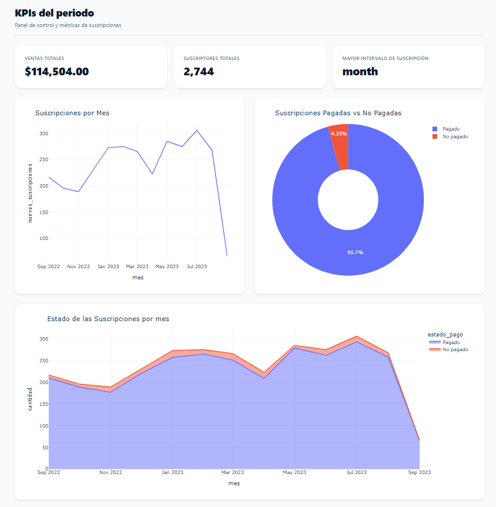

# 📊 Streaming Video Subscriptions Analytics Dashboard

Un panel de control interactivo desarrollado en **Python (Dash & Plotly)** conectado a una base de datos **PostgreSQL** montada en **Docker**, diseñado para analizar métricas clave de rendimiento, ingresos y comportamiento de usuarios para un servicio de streaming de video.

---

## 🚀 Vista Previa del Dashboard

> 

---

## 🛠️ Stack Tecnológico

* **Frontend & Visualización:** Python, Dash, Plotly, HTML/CSS
* **Procesamiento de Datos:** Pandas, NumPy
* **Base de Datos & Almacenamiento:** PostgreSQL
* **Contenedorización:** Docker
* **Gestión de Dependencias:** pip (Entorno Virtual)


## 📈 Características del Proyecto

* **Tarjetas de KPIs:** Visualización en tiempo real de Ventas Totales, Suscriptores Totales y el Intervalo de suscripción con mayor demanda.
* **Análisis Temporal:** Gráfico de líneas para rastrear la evolución de nuevas suscripciones mes a mes.
* **Segmentación de Pagos:** Gráfico de dona que contrasta las suscripciones pagadas frente a las no pagadas.
* **Comportamiento Histórico:** Gráfico de área apilada que muestra el estado de las suscripciones en el tiempo.
* **Arquitectura SQL Real:** Los datos no se leen de archivos planos en caliente; son consultados y agregados mediante consultas SQL estructuradas desde una base de datos relacional.


## 📂 Fuentes y Datos
* **Dataset Original:** [Maven Analytics Data Playground (Streaming Video Subscriptions)](https://mavenanalytics.io/data-playground/streaming-video-subscriptions)
* **Base de Datos:** `videosubs_db`
* **Tabla Principal:** `subscription_cohorts`

---

## ⚙️ Guía de Instalación y Ejecución

Sigue estos pasos en tu terminal (Git Bash o similar) para clonar y correr el proyecto en tu máquina local:

### 1. Clonar el repositorio
```bash
git clone [https://github.com/juniorleyer1/dash-postgres-subscription-analytics.git](https://github.com/juniorleyer1/dash-postgres-subscription-analytics.git)
cd dash-postgres-subscription-analytics